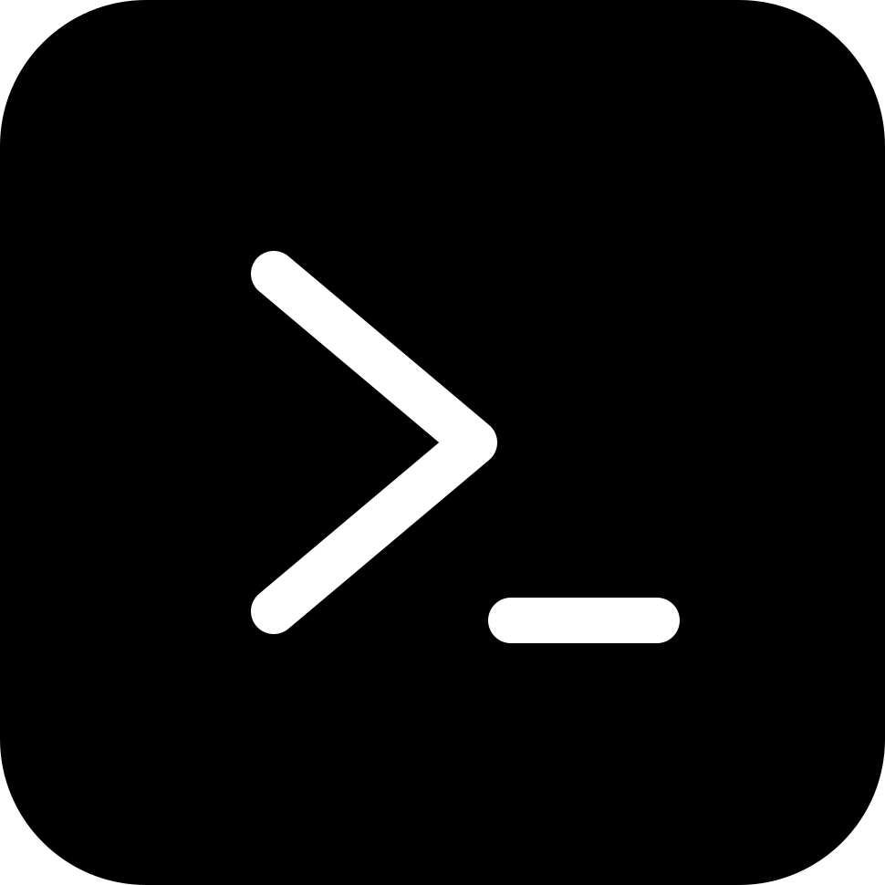

<div align="center">
  
  <h1>gray-prompt</h1>
  <p><strong>Layered prompt customization, plus the input shaping that feeds it.</strong></p>
  <p>
    <a href="https://gray.alignment.id">Website</a> ·
    <a href="https://gray.alignment.id/plugins/gray-prompt">Store</a> ·
    <a href="https://github.com/vstaln/gray-prompt">Source</a> ·
    <a href="https://github.com/vstaln/gray">gray</a>
  </p>
  <p>
    <a href="LICENSE"></a>
    <a href="https://www.rust-lang.org"></a>
    <a href="https://gray.alignment.id/plugins/gray-prompt"></a>
  </p>
</div>

<br/>

```bash
gray plugin install prompt
```

One sidecar for everything that shapes the prompt: the prompt files this
plugin has always injected, and the four input plugins that were
`gray-input`, each kept as a **part** that can be switched on or off on its
own.

| Part | Was | Hook | Commands | State |
|---|---|---|---|---|
| `custom` | `gray-prompt` | `prompt/context` | `/prompt` | `~/.gray/prompt/custom.md`, `<cwd>/.gray-prompt.md` |
| `commands` | `gray-commands` | — | `/cmd` | `~/.gray/commands/*.md` |
| `preset` | `gray-preset` | — | `/preset` | `~/.gray/presets/*.md` |
| `transform` | `gray-transform` | `input/submit` | `/transform` | `~/.gray/transform/rules.json` |
| `inline-bash` | `gray-inline-bash` | `input/submit` | `/inline` | `~/.gray/inline-bash/disabled` |

`custom` is **on by default**; the four input parts are **off by default**,
so installing this bundle changes nothing until you turn one on. There is no
overview command: `/prompt` belongs to `custom` and means what it always did.

## The `custom` part

On `prompt/context`, every customization file that exists is injected, in
order:

1. `~/.gray/prompt/custom.md` — global, applies to every session
   (`$GRAY_HOME` honored, `$HOME/.gray` fallback)
2. `<session.cwd>/.gray-prompt.md` — per-project

Each file is capped at 8 KiB. When nothing is found, the hook returns `{}`
and injects nothing. `/prompt` lists what the last `prompt/context` call
actually injected: source paths and byte sizes.

## Turning parts on and off

Parts are toggled through gray core, which is the only writer of the state file
`$GRAY_HOME/plugins/parts.json` (overrides only):

```sh
gray plugin parts prompt              # table: part, on/off, default, description
gray plugin enable prompt/inline-bash # also: gray plugin enable inline-bash
gray plugin disable prompt/custom
```

The file itself holds only overrides, so anything absent keeps its default:

```json
{ "prompt": { "commands": true, "transform": true } }
```

A disabled part contributes nothing to the manifest — no slash commands, no
hooks, no capabilities — and never sees a request. Enabled parts keep the
commands, state directories and behaviour they had as standalone plugins.

## The `input/submit` chain

Submitted text passes through the enabled stages in a fixed order:

```
commands → preset → transform → inline-bash
```

Each stage sees the text the previous stage produced. A `{text}` result
rewrites the input and passes it on. `{handled: true}` swallows the input and
stops the chain. `{}` passes the input through unchanged. commands and preset
have no `input/submit` hook upstream, so for now they always pass. Because
the chain is ordered, a transform rule can produce a shell line for
inline-bash. For example, `{"prefix":"?sh","rewrite":"!{rest}"}` makes
`?sh ls` run `ls` inline.

Capabilities are the union of the enabled parts: `host.say` (transform,
inline-bash) and `host.ask` (the `/cmd` and `/preset` pickers). None of the
parts registers tools.

## Wire methods

`plugin/manifest` · `prompt/context` (hook) · `input/submit` (hook) ·
`command/run` (`/prompt`, `/cmd`, `/preset`, `/transform`, `/inline`) ·
`plugin/shutdown`

## Install

```sh
gray plugin install prompt
```

## Develop

```sh
cargo fmt
cargo build --release
gray account check      # entry point + manifest handshake
gray account publish    # check → build → release → publish to the gray registry
```

Bump `version` in `Cargo.toml` before each `publish`; the registry refuses to
republish a version.

## Tags

`gray` `plugin` `prompt` `commands` `preset` `transform` `inline-bash` `rust`

---
Part of the [gray](https://github.com/vstaln/gray) plugin ecosystem —
the open-source AI agent harness. <https://gray.alignment.id>
